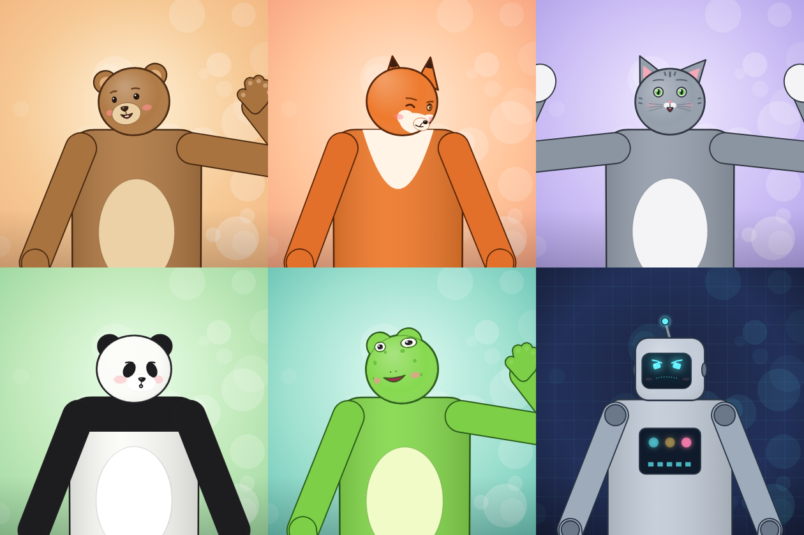

# Sentinel Mirror

**Your camera, your face, a cartoon reflection.** Pick a character (a teddy bear, a fox, a kitty, a panda, a frog, or a robot) and it becomes your reflection on screen. It blinks when you blink, smiles when you smile, raises its brows, opens its mouth when you talk, turns and tilts its head with you, and waves when you wave.

It runs entirely in the browser: one HTML file, no install, no account. It works on phones and on computers with a webcam.

## How to use it

1. Open the page and tap **Start**. Allow camera access when asked.
2. Face the camera in good light, with your head and shoulders in view. Wait for "Face ready".
3. Look straight at the screen for a moment. The app takes that as "straight ahead". (Tap **Recenter** any time to set it again.)
4. Make faces! Blink, wink, smile, frown, raise your brows, open your mouth, puff your cheeks, turn and tilt your head.
5. Raise your arms and wave. With hand tracking on, your character's paws copy your fingers: point, give a thumbs up, or count to five.
6. Tap a character at the bottom to switch.

### Controls

| Control | What it does |
|---|---|
| **Characters** (or keys `1`–`6`, `←` `→`) | Switch between Teddy, Fox, Kitty, Panda, Frog, and Robot. |
| **Background** (`B`) | **Scene** (each character has its own), **Camera** (your character stands in your real room), or **Green screen** (for streaming and video editing). |
| **Camera window** | Shows your real camera in a small window so you can compare. |
| **Recenter** (`R`) | Sets your current head position as "looking straight ahead". |
| **Photo** (`P`) | Saves a picture of your character. |
| **Rec** (`V`) | Records a clip, up to 2 minutes, with your voice from the mic. Save it or share it. |
| **Hide** (`H`) | Hides the buttons for a clean picture. |
| **⚙ Settings** | Camera picker, what to track, how strong the expressions are, smoothness, mic on or off for clips, mirror on or off, tracking points, and Swap face sides. |

### No camera?

Move the pointer and your character looks around. Hold the mouse button (or your finger) down and it talks.

## How it works

| Piece | What it does |
|---|---|
| **Face tracking** | [MediaPipe Face Landmarker](https://ai.google.dev/edge/mediapipe/solutions/vision/face_landmarker) finds 478 points on your face and 52 expression values (blink, brow raise, smile, jaw open, cheek puff, gaze and more) in every video frame, right in your browser. |
| **Head pose** | Turn (yaw), nod (pitch), and tilt (roll) are worked out from 3D points on your cheeks, forehead, chin, and eye corners. Recenter subtracts your natural resting angle. |
| **Arms and hands** | [MediaPipe Pose Landmarker](https://ai.google.dev/edge/mediapipe/solutions/vision/pose_landmarker) tracks your shoulders, elbows, and wrists. [MediaPipe Hand Landmarker](https://ai.google.dev/edge/mediapipe/solutions/vision/hand_landmarker) tracks 21 points per hand for the fingers. Where the camera cannot see an elbow, a two-bone arm solver places it naturally. |
| **Cartoon body** | Real shoulders sit far below the face, so the character's shoulders are tucked up under its head and pulled in. They still follow your lean, tilt, and shrug, and the paws still go exactly where your hands are. |
| **The characters** | Every character is drawn live in code (Canvas 2D), with no images. Eyes, brows, nose, and mouth sit on an imaginary sphere, so they shift and foreshorten when the head turns. Ears and the robot's antenna bounce on springs. |
| **Which eye is which** | The app compares how open each eye looks on screen with the blink values, so a wink lands on the correct side even if your camera or browser flips things. **Swap face sides** in Settings overrides it if needed. |
| **Smoothing** | Every value is smoothed so the character moves fluidly instead of jittering. Blinks stay fast, and head and body motion are steadier. |

The camera image is processed on your device. Nothing from your video is uploaded anywhere. The tracking library and models are downloaded from public CDNs when the app loads, so you need an internet connection.

## Tips

- Even, front-facing light makes the biggest difference. A window or lamp behind you makes your face too dark to read.
- Keep your whole face in view. For arms, step back so your shoulders and elbows are visible too.
- If your phone gets slow or warm, open **Settings → Track** and pick **Face + arms** or **Face only**.
- Turn **Expressions** up for big cartoon reactions, or down for subtle ones.
- **Green screen** plus **Rec** gives you a clip you can drop into a video editor, or use the page as a source in OBS for streaming.
- A phone used as a webcam (for example with DroidCam) and a computer monitor works well.

## Limits to know about

- Tongue out is not tracked. The face tracker does not report it.
- Hands that are too close to the camera or partly out of frame may drop out for a moment. The paw then becomes a round mitten until tracking picks it back up.
- Expression values differ a little from person to person. If a character looks grumpy or smiley at rest, adjust **Expressions** or try better light.

## Running it yourself

It is a single file named `index.html`, with no build step.

- **GitHub Pages:** Upload `index.html` (and `screenshot.png` for this README) to a repo and enable Pages. It works over https.
- **Locally:** Serve the folder from localhost, for example `python3 -m http.server`, and open `http://localhost:8000`.

Browsers only allow camera access on https pages or localhost, so opening the file directly from your disk will not work.

## Troubleshooting

- **"Camera blocked":** Allow camera access for the site (lock icon in the address bar), then reload.
- **"Face tracking failed to load":** The tracking library could not be downloaded. Check your connection and reload.
- **Character winks the wrong eye:** Turn on **Settings → Swap face sides**.
- **Head turns or nods the wrong amount:** Look straight at the screen and tap **Recenter**.
- **Turn on Show tracking points** in Settings to see exactly what the camera is picking up, with live numbers for head angles and expressions.

## Built with

- [MediaPipe Tasks Vision](https://www.npmjs.com/package/@mediapipe/tasks-vision) for face, pose, and hand tracking
- Canvas 2D for the characters
- MediaRecorder for clips
- Plain HTML, CSS, and JavaScript

## About

Part of the Sentinel family of projects by James Keith Harwood II, [Sentinel AI Systems](https://www.jameskeithharwood.com). It grew out of the camera and hand tracking in Sentinel Spotter and Sentinel Air Strings.

Built by James with Claude (Anthropic) as his partner and collaborator.
